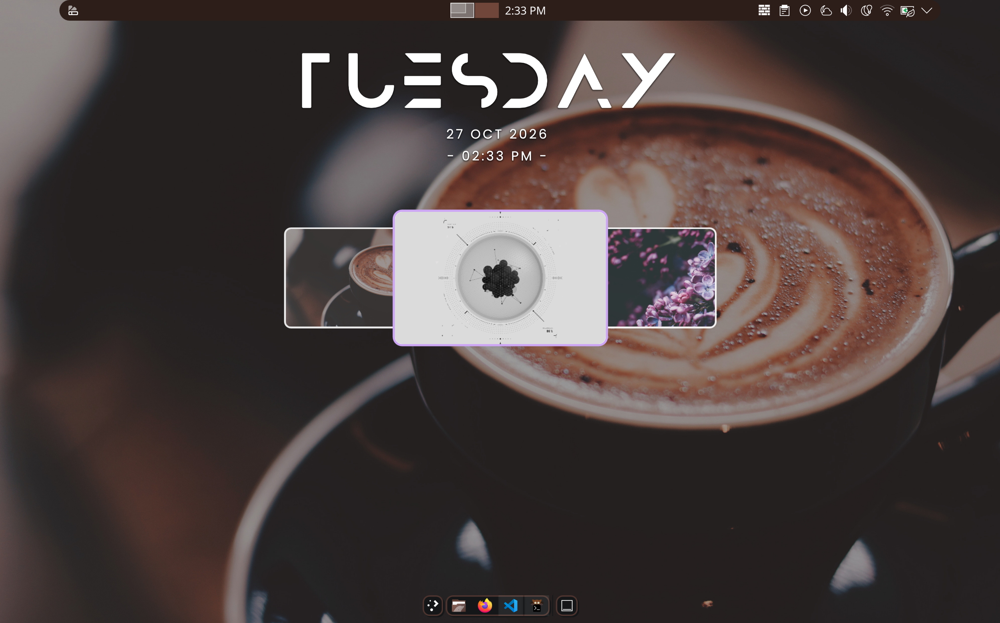

# Quickshell Wallpaper Selector

A lightweight, on-demand wallpaper selector for KDE Plasma on Wayland, built with **Quickshell and QML**.

Preview wallpapers in an animated carousel, navigate using keyboard shortcuts, and apply your selection without opening a separate settings window.

## Preview



## Demo

https://github.com/user-attachments/assets/ca36e45d-b573-407d-8b66-d4b0b383f447

The demo showcases the selector opening on demand, navigating between wallpaper previews, applying a wallpaper, and closing automatically.

## Features

- **On-demand launch:** Open the selector using a custom keyboard shortcut.
- **Animated carousel:** Browse wallpaper previews with smooth scaling animations.
- **Keyboard navigation:** Use the left and right arrow keys to browse and Enter to apply.
- **Mouse interaction:** Click to select a wallpaper or double-click to apply it.
- **Visual selection:** Highlighted borders and scaling identify the selected wallpaper.
- **Automatic exit:** Close the selector after applying a wallpaper.
- **Custom wallpaper collection:** Load images from your own wallpaper directory.

## Requirements

- Linux with KDE Plasma on Wayland.
- [Quickshell](https://quickshell.org/) installed and available in your `PATH`.
- The Qt/QML modules required by your Quickshell installation, including `Qt.labs.folderlistmodel` and `Qt5Compat.GraphicalEffects`.
- KDE Plasma's `plasma-apply-wallpaperimage` utility.
- `pkill` and `pgrep` for the supplied toggle script.

## Installation

### 1. Clone the repository

```bash
git clone https://github.com/Roshin036/quickshell-wallpaper-selector.git
cd quickshell-wallpaper-selector
```

### 2. Prepare your wallpapers

The selector reads images from:

```text
~/Pictures/Wallpapers
```

Create the directory if necessary and add your own wallpapers. PNG, JPG, JPEG, and WebP files are supported.

```bash
mkdir -p ~/Pictures/Wallpapers
```

### 3. Install the configuration

Back up your existing Quickshell configuration before proceeding.

```bash
mkdir -p ~/.config/quickshell

cp shell.qml toggle_selector.sh ~/.config/quickshell/

chmod +x ~/.config/quickshell/toggle_selector.sh
```

Review existing configuration files before copying anything into an already populated directory.

### 4. Configure a keyboard shortcut

In KDE Plasma System Settings, open the custom keyboard shortcuts section and create a command shortcut pointing to:

```text
~/.config/quickshell/toggle_selector.sh
```

Choose a key combination that does not conflict with an existing shortcut.

### 5. Use the selector

1. Trigger your configured shortcut.
2. Browse wallpapers using the left and right arrow keys.
3. Press Enter to apply the selected wallpaper, or double-click a preview.
4. The selector closes after applying the wallpaper.

## Project Structure

```text
quickshell-wallpaper-selector/
├── shell.qml
├── toggle_selector.sh
├── README.md
├── LICENSE
├── screenshots/
│   └── wallpaper-selector.png
└── demo/
    └── demo.mp4
```

## How It Works

The interface uses Quickshell's `PanelWindow` to display a transparent overlay, `FolderListModel` to discover wallpapers, and `PathView` to arrange previews in an animated carousel.

The shell script toggles Quickshell on demand. When a wallpaper is selected, the interface invokes KDE Plasma's `plasma-apply-wallpaperimage` utility to apply the selected image.

## Warning and Customization

**Process management:** The default `toggle_selector.sh` uses `pkill -x quickshell` to close Quickshell processes. Depending on your configuration, this can terminate other Quickshell widgets or components running on your desktop.

If you use other Quickshell components, consider editing the script to launch and terminate only the wallpaper selector instance. Review the process-management behavior before using this script alongside other Quickshell configurations.

**Wallpaper directory:** To use a different wallpaper folder, edit the `folder` property in `shell.qml`.

**Keyboard shortcut:** Configure the shortcut through your desktop environment. The key combination itself is not hardcoded in the QML file.

**Dependencies:** The required Qt/QML modules and commands may vary depending on your distribution and Quickshell installation.
